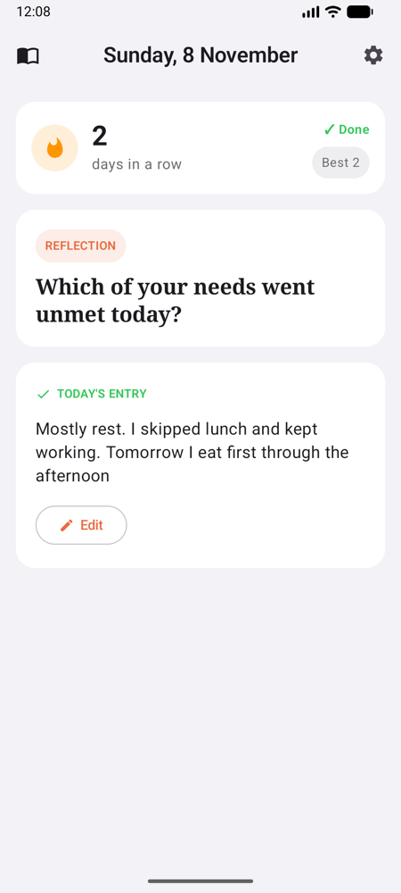
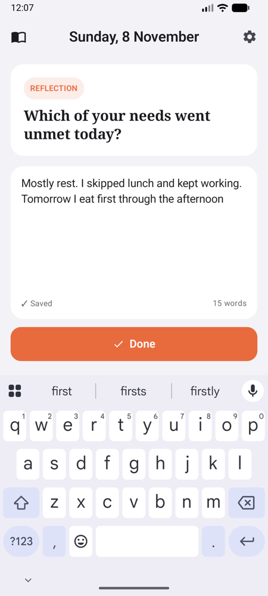
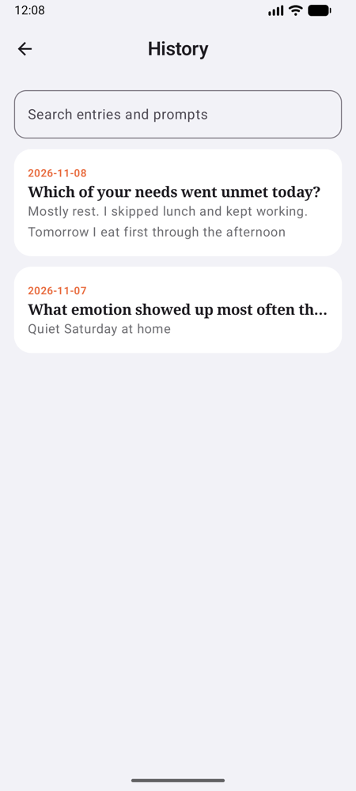
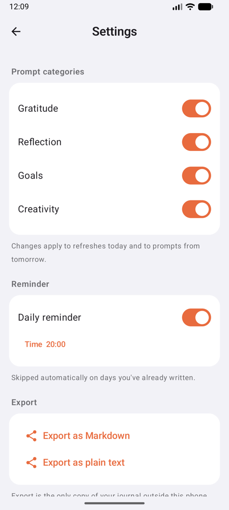

# Daily Journal for Android

The Android version of Daily Journal: one journaling prompt a day, a quick text entry, a streak counter, and a Home Screen widget.

This project is being built with the AI-DLC workflow (see [`CLAUDE.md`](CLAUDE.md)); planning and design documents live in [`aidlc-docs/`](aidlc-docs/). Done so far: the **domain** module (all business rules, ported from the iOS app and checked against it), the **data** module (storage, prompts, reminders, clock) and the **app** (all screens). The Home Screen widget comes next.

## Screenshots

| Today | Writing | History | Settings |
|---|---|---|---|
|  |  |  |  |

## Layout

| Module | Contents |
|---|---|
| `domain/` | Pure Kotlin business rules: prompt selection, entries, streak, search, export, reminders, use cases |
| `data/` | Room database for entries, DataStore for settings and prompt state (same JSON as iOS), the 600-prompt library, reminders and notifications, the clock |
| `app/` | The Android app: onboarding, Today with the editor, yesterday's backfill, History, entries, Settings and export, reminders |
| `widget/` | Home Screen widget (skeleton for now) |

## Prerequisites

- JDK 17 or newer
- Android SDK with platform API 37 (installed with Android Studio). Gradle finds it through `ANDROID_HOME` or a git-ignored `local.properties` with `sdk.dir=...`

No separate Gradle install is needed; use the wrapper.

## Build and test

```sh
./gradlew build                      # compile all modules (warnings are errors) and run all tests
./gradlew :domain:test               # domain tests only: example-based, property-based, performance smoke
./gradlew :data:testDebugUnitTest    # data tests (Robolectric: Room, DataStore, notifications on the JVM)
./gradlew :app:testDebugUnitTest     # app ViewModel tests
./gradlew :app:assembleRelease       # release APK in app/build/outputs/apk/release/
./gradlew koverHtmlReport            # coverage report in build/reports/kover/html
```

Property-based tests use a new random seed on every run. If one fails, the output shows the smallest failing input and a line like `Repeat this test by using seed 123`; set that seed in the test's `PropTestConfig` to replay it.

## Install on your phone

The release build is shrunk, strips debug logs and isn't debuggable. It's signed with the debug key Android Studio created on this Mac, so there's no keystore to manage.

1. On the phone, turn on **Developer options** and **USB debugging**, then connect it with a USB cable and accept the prompt.
2. Build and install:

   ```sh
   ./gradlew :app:assembleRelease
   adb install -r app/build/outputs/apk/release/app-release.apk
   ```

   If more than one device is connected, add `-s <serial>` (from `adb devices`).

Updates install over the previous version and keep your journal. If this Mac's debug key is ever lost, the next install needs an uninstall first, which deletes the journal on the phone, so **export first** (Settings → Export).

### Releases

Set `versionName` (for example `1.0.1`) and increase `versionCode` by one in `app/build.gradle.kts`, commit, and tag the commit you install: `git tag v1.0.1 && git push origin v1.0.1`. To roll back, check out the previous tag, build, and install it with `adb install -r -d …` (`-d` allows the older version; your journal is kept).

## Dependencies and supply chain

- Every version is pinned in `gradle/libs.versions.toml`, and only Google Maven and Maven Central are used.
- `gradle/verification-metadata.xml` holds a SHA-256 checksum for every downloaded file; the build fails if a file doesn't match. After changing a dependency, regenerate it:

  ```sh
  ./gradlew --write-verification-metadata sha256 --refresh-dependencies --no-configuration-cache build :app:assembleRelease koverXmlReport koverHtmlReport
  ```

  and review the changes before committing. `--refresh-dependencies` makes Gradle fetch every file again, so metadata cached by earlier builds (such as parent POMs) is recorded too.
- CI (`.github/workflows/ci.yml`) builds and tests every push and pull request, and submits the dependency graph to GitHub from `main`.
- **One-time setting**: turn on **Dependabot alerts** in the repository's Settings → Code security, so GitHub warns about known vulnerabilities. An SBOM can be exported from Insights → Dependency graph → Export SBOM.
