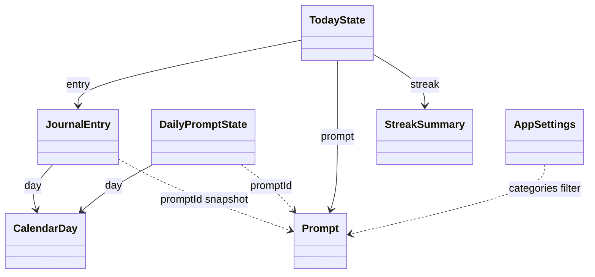

# Domain Entities: Unit 1 Domain (`:domain`)

**Base**: iOS `domain-entities.md`, ported with the same names (plan Q1:A). Android differences are marked **Android:**. Sync-only parts are dropped.

All types are immutable Kotlin `data class`es, `enum class`es or `sealed interface`s with no Android dependencies. Time types come from kotlinx-datetime (`Instant`, `TimeZone`, `LocalTime`).

This document refines `component-methods.md` §1. Changes are marked **(refined)**.

---

## 1. Time Model

### 1.1 `TimeSource` (port)
| Member | Meaning |
|---|---|
| `now: Instant` | Current instant |
| `timeZone: TimeZone` | Device's current time zone |

### 1.2 `DayMath`
All day arithmetic uses the ISO (proleptic Gregorian) calendar in `TimeSource.timeZone`. Journal days are civil Gregorian dates, so an entry gets the same `CalendarDay` on every device and on iOS.

### 1.3 `CalendarDay`
| Field | Type | Invariant |
|---|---|---|
| `year` | Int | 1…9999 |
| `month` | Int | 1…12 |
| `day` | Int | 1…days in that month |

| Derived | Definition |
|---|---|
| `dayNumber` | **Days since 2001-01-01** (day 0), pure integer arithmetic, no time zone. **(refined)** `component-methods.md` said 1970; it must be 2001 to match iOS, because prompt selection uses it (BR-P2) |
| `key` | `"YYYY-MM-DD"` zero-padded; storage key and route argument |
| `adding(days)` | Integer math on `dayNumber`, converted back to Y/M/D; DST can never shift it |
| `containing(instant, timeZone)` | Gregorian Y/M/D of the instant in that zone |
| `startIn(timeZone)` | First instant of the day (handles days that don't start at 00:00 because of DST) |
| `noonIn(timeZone)` | 12:00 local; if a DST gap removes 12:00, the next valid instant after it |
| `fromKey(key)` | Parses `"YYYY-MM-DD"`; returns `null` for anything else, including impossible dates (NFR-6.3) |

Ordered by `dayNumber`. Never stores a time zone (NFR-3.2).

---

## 2. Prompts

### 2.1 `PromptCategory`
`GRATITUDE`, `REFLECTION`, `GOALS`, `CREATIVITY`, each with a raw value equal to the lowercase name (`"gratitude"`, …), used in JSON, settings and the category key.

`categoryKey(categories)` = raw values sorted alphabetically, joined with `","` (e.g. `"creativity,goals,gratitude,reflection"`). Identical to iOS `PromptCategory.key(for:)`.

### 2.2 `Prompt`
| Field | Type | Invariant |
|---|---|---|
| `id` | String | Unique; format `<category>-<NNN>` |
| `category` | PromptCategory | Matches the id prefix |
| `text` | String | 10–200 characters after trimming |

### 2.3 `DailyPromptState` (per device)
| Field | Type | Meaning |
|---|---|---|
| `day` | CalendarDay | The day it belongs to |
| `promptId` | String | Prompt currently shown for the day |
| `refreshesUsed` | Int | 0…3 |
| `shownPromptIds` | List<String> | Every prompt shown that day, in order |
| `categoriesKey` | String | Category key in effect at the daily pick (diagnostics) |

Only today's and yesterday's states are kept.

---

## 3. Entries

### 3.1 `JournalEntry`
| Field | Type | Invariant |
|---|---|---|
| `id` | String (UUID text) | Stable identity |
| `day` | CalendarDay | Journal day; never derived from `createdAt` |
| `text` | String | Valid per BR-E2: at least one non-whitespace character; **Android:** at most 20,000 characters (Unicode code points). Stored exactly as typed |
| `promptId` | String | Frozen at creation |
| `promptText` | String | Snapshot of the prompt text |
| `createdAt` | Instant | First save |
| `updatedAt` | Instant | ≥ `createdAt`; last save |

`JournalEntry.MAX_LENGTH = 20_000` **(refined, Android)**. "Whitespace" means characters with the Unicode White_Space property, matching Swift's `.whitespacesAndNewlines` for all characters in the test generators.

Relationship: **exactly zero or one entry per `CalendarDay`**. **Android:** with no sync, there are never duplicates, so the iOS merge model is not needed.

### 3.2 `EntryEditability`
| Case | Meaning |
|---|---|
| `Editable(until)` | The day is today; create or edit until `until` (next local midnight) |
| `Backfillable(until)` | The day is yesterday, it has no entry, and `now` is before today's noon |
| `Locked` | Everything else, including future-dated days |

### 3.3 `BackfillOffer`
`day` (yesterday), `prompt`, `until` (today's noon).

### 3.4 `EntryDetail`
`entry`, `editability`.

---

## 4. Streak

### 4.1 `StreakStatus`
| Case | Meaning |
|---|---|
| `None` | current = 0 |
| `Active` | Streak runs through today, or through yesterday with today still open |
| `AtRisk(restorableCount, until)` | Yesterday is missing and today's 12:00 hasn't passed; backfilling would restore a run of `restorableCount` days |

### 4.2 `StreakSummary`
| Field | Type | Invariant |
|---|---|---|
| `current` | Int | ≥ 0 |
| `best` | Int | ≥ `current` |
| `status` | StreakStatus | See above |
| `isTodayDone` | Boolean | Today has an entry, or a future-dated entry exists |

---

## 5. Aggregates and Settings

### 5.1 `TodayState`
`day`, `prompt` (the entry's frozen prompt if today is done), `entry` (today's or a future-dated one), `entryEditability`, `refreshesRemaining` (0 when done), `backfillOffer`, `streak`, `onboardingCompleted`.

### 5.2 `ReminderSettings`
| Field | Default | Invariant |
|---|---|---|
| `isEnabled` | false | n/a |
| `hour` | 20 | 0…23 |
| `minute` | 0 | 0…59 |

**(refined)** hour and minute fields like iOS, instead of `LocalTime`, so the stored form matches iOS.

### 5.3 `AppSettings`
| Field | Default | Invariant |
|---|---|---|
| `categories` | all four | Never empty |
| `reminder` | defaults above | n/a |
| `onboardingCompleted` | false | n/a |

### 5.4 `ScheduledReminder` **(refined: same fields as iOS)**
| Field | Meaning |
|---|---|
| `identifier` | `"reminder-" + day.key` |
| `day` | Day it fires |
| `fireAt` | Local hour:minute on that day; next valid instant if a DST gap removes it |
| `title` | `"Time to journal"` |
| `body` | See BR-R4 |
| `deepLink` | `DeepLink.TodayEditor` |

### 5.5 `ReminderAuthorization`
`NOT_DETERMINED`, `ALLOWED`, `DENIED`. **Android:** on Android 10–12 notifications need no runtime permission, so the Data unit reports `ALLOWED` unless the user turned notifications off for the app.

### 5.6 Export
`ExportFormat`: `MARKDOWN`, `PLAIN_TEXT`. `ExportDocument`: `fileName`, `mimeType` (**Android:** `"text/markdown"` or `"text/plain"` instead of iOS type identifiers), `contents`.

### 5.7 `DeepLink`
| Case | URI |
|---|---|
| `TodayEditor` | `dailyjournal://today` |
| `BackfillEditor` | `dailyjournal://backfill` |

`parse(uri)` accepts only the `dailyjournal` scheme with a known host, ignores query and fragment, and returns `null` for anything else (NFR-6.3). Same URIs as iOS.

---

## 6. `JournalError` Catalogue **(refined)**

| Case | Raised by | User-facing meaning (wording owned by the App unit) |
|---|---|---|
| `EmptyText` | SaveTodayEntry, BackfillYesterday | "Write something first." |
| `TextTooLong` **(Android, new)** | SaveTodayEntry, BackfillYesterday | "You've reached the maximum length for one entry." |
| `EntryLocked` | SaveTodayEntry, RefreshPrompt | "This entry is locked." |
| `BackfillNotAvailable` | BackfillYesterday | "Yesterday can no longer be filled in." |
| `NoRefreshesLeft` | RefreshPrompt | "No refreshes left today." |
| `CategoriesEmpty` | UpdatePromptCategories, CompleteOnboarding | "Choose at least one category." |
| `NotificationsDenied` **(refined: added; was missing from component-methods)** | ConfigureReminder, CompleteOnboarding | "Notifications are off for this app." |
| `NothingToExport` **(refined: added)** | ExportJournal | "No entries to export yet." |
| `StorageFailure(reason)` | Any use case whose port call fails | Generic "Couldn't save. Try again." The reason is for logs only and never contains journal text (NFR-6.2) |

---

## 7. Relationships

Text alternative: a JournalEntry belongs to one CalendarDay and keeps a snapshot of one Prompt. DailyPromptState belongs to one CalendarDay and points to one Prompt. TodayState combines the current Prompt, an optional JournalEntry and a StreakSummary. AppSettings categories filter which Prompts are eligible.
