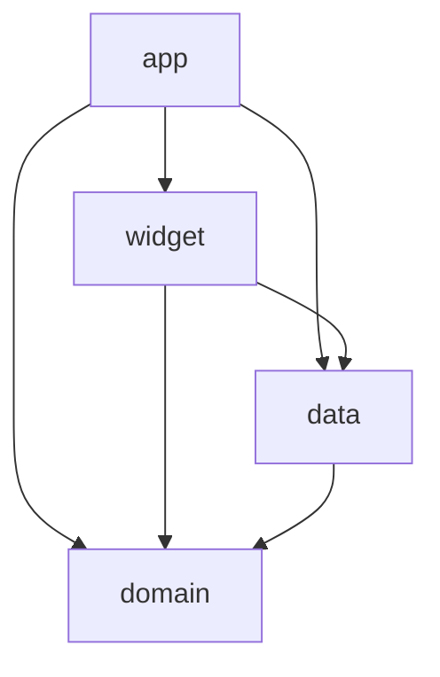

# Application Design: Daily Journal for Android

Consolidated view of `components.md`, `component-methods.md`, `services.md` and `component-dependency.md`. Those files hold the full detail.

## 1. Design Decisions

| # | Decision | Effect |
|---|---|---|
| Q1 | ViewModels per screen | Typed text and loaded data survive rotation, theme changes and process recreation |
| Q2 | One use case per user action, iOS names | 14 use cases, directly comparable with iOS |
| Q3 | Domain ports, data implementations | Domain is pure Kotlin and testable on the JVM with fakes |
| Q4 | Manual injection, one `AppContainer` | No DI library; widget and receivers use `JournalEnvironmentProvider` |
| Q5 | Reactive change signals | Ports expose `changes: Flow<Unit>`; `ClockEvents` emits at midnight, 12:00 and time changes; ViewModels re-run use cases |
| Q6 | Widget computes with the domain | Always correct, even if the app hasn't run today |
| Q7 | Navigation Compose, typed routes | Single activity; widget and reminder taps clear the back stack to Today |
| Q8 | Official Kotlin, AndroidX and Google libraries only in shipped code | Small supply chain (NFR-6.5); Kotest for tests only |
| Q9 | Port the iOS domain file by file | Same rules and prompt picks as iOS; iOS test scenarios reused |

**Not ported**: the iOS sync pieces (`DayEntryMerger`, `ReconcileSyncedEntriesUseCase`, `RemoteChangeObserver`, duplicate-day functions). Android has no sync, so one entry per day is enforced by a unique constraint instead.

## 2. Modules and Components

| Module | Contents |
|---|---|
| `:domain` | Entities (`CalendarDay`, `JournalEntry`, `Prompt`, `DailyPromptState`, `StreakSummary`, `EntryEditability`, `TodayState`, `AppSettings`, `DeepLink`, `JournalError`, …); policies (`PromptSelector`, `StableHash`, `DayMath`, `EntryEditPolicy`, `StreakCalculator`, `JournalExporter`, `EntrySearchMatcher`, `ReminderPlanner`, `PromptLibraryValidator`); ports (`TimeSource`, `EntryRepository`, `PromptLibrary`, `PromptStateStore`, `SettingsStore`, `ReminderScheduler`, `WidgetRefresher`); 14 use cases in `JournalUseCases` |
| `:data` | Entry database and repository (unique per day, non-destructive migrations), bundled `prompts.json` (same as iOS), preferences stores for settings and prompt state, `SystemTimeSource`, `ClockEvents`, `AndroidReminderScheduler`, `ReminderNotifier`, `JournalEnvironmentFactory`, `JournalEnvironmentProvider` |
| `:app` | `JournalApplication`, `AppContainer`, `MainActivity`, `JournalNavGraph`, `DeepLinkRouter`, ViewModels and screens (Onboarding, Today, Editor, Backfill, History, Entry detail, Settings), `ExportSharer`, `ReminderReceiver`, `RescheduleReceiver`, design system, manifest configuration |
| `:widget` | `PromptStreakWidget`, `PromptStreakWidgetReceiver`, `WidgetStateLoader`, `WidgetUpdateScheduler`, `GlanceWidgetRefresher` (implements the `WidgetRefresher` port; passed in by the app) |

Storage library and reminder scheduling mechanism are chosen in NFR Requirements (Room, DataStore and AlarmManager expected).

## 3. Main Flows (from `services.md`)

| Flow | Summary |
|---|---|
| S1 Open Today | Settings decide Onboarding or Today; `GetTodayStateUseCase`; editor focused if not done; reload on signals |
| S2 Save entry | Autosave and Done through `SaveTodayEntryUseCase`; editor stays visible; failures keep text |
| S3 Midnight while editing | Editor flushes pending text, locks its own day, shows a message; Today moves on behind it |
| S4 Refresh | `RefreshPromptUseCase`, limit 3, widget refreshed |
| S5 Backfill | Sheet with yesterday's prompt until 12:00; Back confirms discard |
| S6 History | List, debounced search, detail read-only or editable; Back rules from stories |
| S7 Settings | Permission state checked on every open; categories; reminder; export through private cache and share sheet |
| S8 Reminders | Planned for the next days, skipped when done, rechecked at fire time, rescheduled on boot and time changes |
| S9 Widget | Computes Today state itself; updates after writes and at midnight and 12:00 |
| S10 Deep links | Explicit immutable intents; known links clear to Today; unknown links do nothing else |
| S11 Onboarding | Two steps, permission only if reminder chosen |
| S12 Errors | Typed storage errors, generic messages, top-level handler, no journal text in logs |

## 4. Dependencies

Text alternative: app → widget, data, domain; widget → data, domain; data → domain; domain depends on no project module and no Android code.

## 5. Security Review (Security Baseline extension)

| Rule | Design response | Status |
|---|---|---|
| SECURITY-01 Encryption at rest | All data in the app's private storage, protected by Android file-based encryption; backup and device-transfer opt-out in the manifest; no network | Compliant |
| SECURITY-03 Logging | Platform logger only; logs never contain journal text, prompts or settings; release builds strip debug and verbose logs; no central logging (no server) | Compliant (central logging N/A) |
| SECURITY-05 Input validation | No APIs. Deep links parsed by `DeepLink.parse` with an allowlist; route arguments (`dayKey`) validated by `CalendarDay.fromKey` | Compliant |
| SECURITY-09 Hardening | Release minification; no debug screens or sample code; generic user-facing errors | Compliant (verified in Code Generation) |
| SECURITY-10 Supply chain | Official libraries only (Q8); versions pinned in a version catalog; scanning and SBOM tools chosen in NFR Requirements | Compliant at design level |
| SECURITY-11 Secure design | Security-relevant logic isolated: `DeepLinkRouter`, manifest configuration, `ExportSharer`; misuse cases (clock and time-zone changes) handled by deterministic rules that never corrupt data | Compliant |
| SECURITY-13 Data integrity | Prompt file validated on load; no untrusted deserialization (only the app's own files) | Compliant |
| SECURITY-15 Exception handling | Storage errors mapped to `JournalError.StorageFailure`; ViewModels keep input; top-level handler; no partial writes | Compliant |
| SECURITY-02, 04, 06, 07, 08, 12, 14 | No servers, web content, cloud IAM, network, accounts or log infrastructure | N/A |

No blocking security findings.

## 6. Property-Based Testing Notes (for Functional Design, PBT-01)

Components expected to carry testable properties:

| Component | Property categories |
|---|---|
| `CalendarDay` | Round-trip (`fromKey(key)`), invariants (`adding` and `dayNumber` consistent, ordering) |
| `StableHash`, `PromptSelector` | Oracle (same output as the iOS implementation for fixed vectors), invariants (deterministic, within selected categories, no repeats within the window, refresh never repeats shown prompts) |
| `EntryEditPolicy` | Invariants (only today editable; only a missing yesterday before 12:00 backfillable) |
| `StreakCalculator` | Invariants (current ≤ entry days, best ≥ current, adding an entry never lowers either); oracle (simple day-by-day count) |
| `EntrySearchMatcher` | Invariants (results ⊆ entries; empty query matches all) |
| `JournalExporter` | Invariants (each entry exactly once, in date order, text unchanged) |
| `ReminderPlanner` | Invariants (at most one per day, none on a done day, all in the future) |
| `DeepLink` | Round-trip (`parse(toUri())`), unknown input → `null` |
| Data mappings and stored formats | Round-trip (entry ↔ database row, settings and prompt state ↔ stored form) |
| Use cases with state (refresh, save) | Stateful properties (refresh count never exceeds 3; one entry per day after any sequence of saves) |

## 7. Completeness Check

- Every story (26) maps to components (`components.md` §5); every functional requirement maps to at least one flow in `services.md`.
- Android-only requirements are covered: backup opt-out (manifest), permission on open (S7), reminders after restart (S8), midnight lock (S3), return to Today (S10).
- No dependency points outward from `:domain`; `:widget` doesn't depend on `:app` (uses `JournalEnvironmentProvider`).
- Open for NFR Requirements: storage library, reminder mechanism (exact vs inexact alarms), widget update scheduling mechanism, test and scanning tools.
