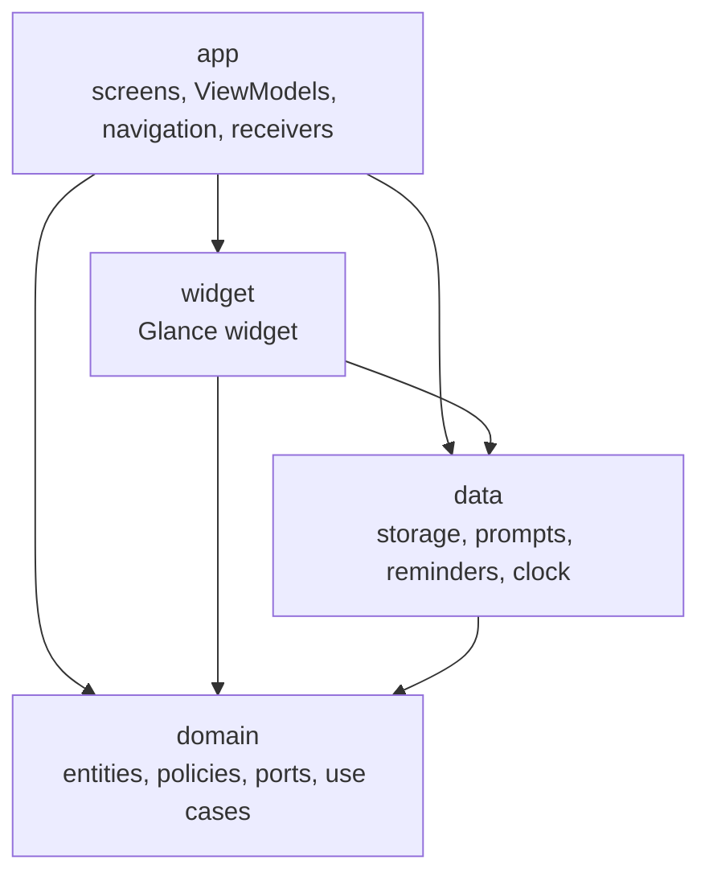
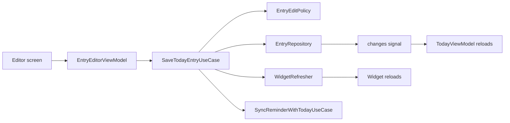
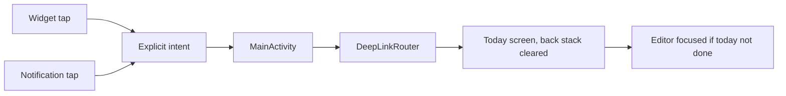

# Component Dependencies

## 1. Module Dependency Rules

| Module | Depends on | Must not depend on |
|---|---|---|
| `:domain` (pure Kotlin) | kotlinx-coroutines-core (for `Flow`), kotlinx-datetime | Android SDK, any other module |
| `:data` (Android library) | `:domain`, storage library | `:app`, `:widget` |
| `:widget` (Android library) | `:domain`, `:data`, Glance | `:app` |
| `:app` (Android application) | `:domain`, `:data`, `:widget`, Compose, Navigation, Lifecycle | (nothing depends on `:app`) |

Dependencies point inward: presentation (`:app`, `:widget`) → `:data` → `:domain`. The domain never knows about Android, so its rules run in plain JVM unit and property-based tests. The Gradle build enforces this through module declarations: a forbidden import doesn't compile.

### Module diagram



Text alternative:
```
app    -> widget, data, domain
widget -> data, domain
data   -> domain
domain -> (nothing in this project)
```

---

## 2. Component Dependency Matrix

Rows depend on columns ("X" = direct dependency).

| Component \ depends on | Use cases | Policies | Ports | Data impls | AppContainer / Provider | ClockEvents | Navigation |
|---|---|---|---|---|---|---|---|
| Use cases | | X | X | | | | |
| Policies | | | | | | | |
| Data implementations | | X (validator) | X (implement) | | | | |
| `JournalEnvironmentFactory` | X | | X | X | | X | |
| ViewModels | X | | | | X | X | |
| Composable screens | | | | | | | X |
| `MainActivity` / `DeepLinkRouter` | | | | | X | | X |
| `ReminderReceiver` / `RescheduleReceiver` | X | | | X (`ReminderNotifier`) | X | | |
| `PromptStreakWidget` / `WidgetStateLoader` | X | | | | X (Provider) | | |
| `WidgetUpdateScheduler` | | X (`DayMath`) | | | | | |

- ViewModels never touch data implementations directly, only use cases and the change signals.
- Composables never call use cases; they render ViewModel state and send events.
- Only `JournalEnvironmentFactory` knows the concrete data classes (composition root).

---

## 3. Communication Patterns

| Pattern | Where | Notes |
|---|---|---|
| Suspend function calls | ViewModel → use case → port | All storage work runs off the main thread inside the data layer |
| `Flow<Unit>` change signals | Ports → `AppContainer.refreshSignals` → ViewModels | Signal only ("something changed"); ViewModels re-run the use case for fresh state |
| `StateFlow` UI state | ViewModel → composable | Survives screen rebuilds |
| System broadcasts | Android → `RescheduleReceiver`, `ReminderReceiver`, `ClockEvents` | Boot, time set, time-zone change, package replaced, alarm |
| Explicit, immutable intents | Widget and notification → `MainActivity` | Deep links parsed by `DeepLink.parse`; unknown → Today (NFR-6.3) |
| Widget update requests | Use cases → `WidgetRefresher`; `WidgetUpdateScheduler` | After writes, and at midnight and 12:00 |

---

## 4. Data Flow

### Save today's entry



Text alternative:
```
Editor -> EntryEditorViewModel -> SaveTodayEntryUseCase
SaveTodayEntryUseCase -> EntryEditPolicy (may it be saved?)
SaveTodayEntryUseCase -> EntryRepository (write) -> changes signal -> TodayViewModel reloads
SaveTodayEntryUseCase -> WidgetRefresher -> widget reloads
SaveTodayEntryUseCase -> SyncReminderWithTodayUseCase -> today's reminder cancelled
```

### Widget and reminder tap



Text alternative:
```
Widget tap or notification tap -> explicit intent -> MainActivity -> DeepLinkRouter
DeepLinkRouter -> Today screen (back stack cleared) -> editor focused if today isn't done
Unknown link -> Today screen only
```

### Day boundaries

```
ClockEvents (00:00, 12:00, time/zone change)
  -> AppContainer.refreshSignals -> ViewModels re-run GetTodayStateUseCase
  -> EntryEditorViewModel re-checks its own day's editability (midnight lock, FR-8.1)
WidgetUpdateScheduler (00:00, 12:00, even when the app isn't running)
  -> PromptStreakWidget -> WidgetStateLoader -> GetTodayStateUseCase
RescheduleReceiver (boot, time/zone change, app update)
  -> SyncReminderWithTodayUseCase -> ReminderScheduler.replacePending
```
