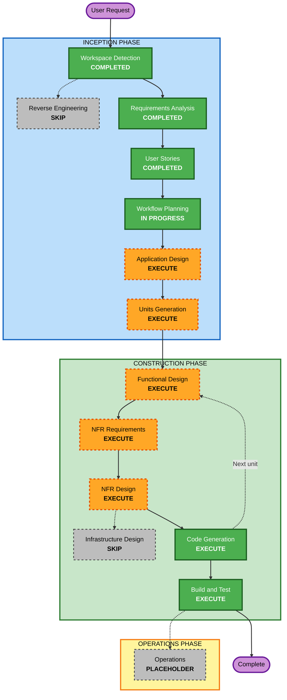

# Execution Plan: Daily Journal for Android

## Detailed Analysis Summary

### Change Impact Assessment
- **User-facing changes**: Yes. A complete new app: Today, History, entry, Settings and onboarding screens, a Home Screen widget and reminder notifications (26 stories).
- **Structural changes**: Yes. New project with four Gradle modules (domain, data, app, widget) following Clean Architecture (NFR-1.3).
- **Data model changes**: Yes. New on-device store for entries, settings and per-day prompt state; bundled prompt library; export formats. The stored day must stay separate from creation time (NFR-3.2), and later versions must keep older data readable (NFR-7.2).
- **API changes**: No network APIs. Internal interfaces only: use cases, repository ports, deep links from the widget and reminders (NFR-6.3).
- **NFR impact**: Yes. Security baseline (NFR-6), property-based testing (NFR-4.3), date and time correctness (NFR-3), speed (NFR-5), on-device privacy with no backup (NFR-2), CI with dependency scanning and SBOM (NFR-4.4, NFR-6.5).

### Risk Assessment
- **Risk Level**: Medium. The business rules are proven on iOS, but the Android platform pieces are new: widget updates without the app running, reminders that survive restarts, Android 13+ notification permission, opting out of backup, and the midnight lock while typing.
- **Rollback Complexity**: Easy. Greenfield project; every release is tagged (NFR-7.2).
- **Testing Complexity**: Moderate. Deterministic clock-driven unit tests and property-based tests for the domain; device behavior (widget, reminders, restart) needs manual checks on a phone or emulator.

### Prerequisite for Construction
- **Android SDK**: not installed on this Mac. You chose to install Android Studio yourself (Q14:A). It is needed before **Code Generation of the first unit**, so generated code can be compiled and tested as it is written. Planning stages before that do not need it.

## Workflow Visualization

### Mermaid Diagram



### Text Alternative

```
Phase 1: INCEPTION
- Workspace Detection (COMPLETED)
- Reverse Engineering (SKIPPED - greenfield)
- Requirements Analysis (COMPLETED)
- User Stories (COMPLETED)
- Workflow Planning (IN PROGRESS)
- Application Design (EXECUTE)
- Units Generation (EXECUTE)

Phase 2: CONSTRUCTION (per unit: domain, data, app, widget - final list set in Units Generation)
- Functional Design (EXECUTE for units with business logic or data transformations)
- NFR Requirements (EXECUTE)
- NFR Design (EXECUTE)
- Infrastructure Design (SKIP)
- Code Generation (EXECUTE, every unit)
- Build and Test (EXECUTE, after all units)

Phase 3: OPERATIONS
- Operations (PLACEHOLDER)
```

## Phases to Execute

### 🔵 INCEPTION PHASE
- [x] Workspace Detection (COMPLETED)
- [x] Reverse Engineering (SKIPPED: greenfield, no existing code)
- [x] Requirements Analysis (COMPLETED)
- [x] User Stories (COMPLETED)
- [x] Execution Plan (IN PROGRESS)
- [ ] Application Design - EXECUTE
  - **Rationale**: New components, use cases and ports need defining in Kotlin: prompt selector, streak calculator, edit policy, repositories, reminder scheduler, widget updater, navigation and deep-link routing. The iOS design is the starting point, but Android adds components with no iOS equivalent (restart receiver for reminders, backup opt-out, notification permission state, midnight-lock handling).
- [ ] Units Generation - EXECUTE
  - **Rationale**: The work splits into separate Gradle modules (NFR-1.3) with a build order (domain first, then data, then app and widget). Units Generation fixes the unit list, dependencies and story mapping, and decides where project setup and CI belong.

### 🟢 CONSTRUCTION PHASE
- [ ] Functional Design - EXECUTE (units with business logic or data transformations)
  - **Rationale**: Detailed business rules (prompt selection algorithm ported exactly from iOS, refresh limit, grace window, streak, midnight lock), the data model and its migration rules, and the export and prompt file formats. Required by the PBT extension: rule PBT-01 makes Functional Design the place where testable properties are identified for every unit with business logic. Expected for domain and data; skipped for app and widget unless Units Generation finds rules there.
- [ ] NFR Requirements - EXECUTE
  - **Rationale**: The tech stack is not fixed yet (unlike iOS): storage library, widget library version, reminder scheduling (exact vs inexact alarms, open point 3 in the stories), Kotest setup, dependency scanning and SBOM tools, minimum and target SDK versions. Also required by PBT-09 (framework recorded in tech stack decisions) and the Security extension (SECURITY-10 supply chain).
- [ ] NFR Design - EXECUTE
  - **Rationale**: Turns the NFRs into concrete patterns: backup opt-out configuration, logging that never includes journal text, release hardening, deep-link validation, top-level error handling, non-destructive database migrations, and performance targets for launch and search.
- [ ] Infrastructure Design - SKIP
  - **Rationale**: No cloud or server resources (NFR-2.1). The only infrastructure is the GitHub Actions workflow, which is a code file created during Code Generation.
- [ ] Code Generation - EXECUTE (ALWAYS)
  - **Rationale**: Implementation with tests for every unit, planned and approved per unit.
- [ ] Build and Test - EXECUTE (ALWAYS)
  - **Rationale**: Full build, unit and property-based tests, CI run, and manual checks of the widget, reminders and restart behavior on a phone or emulator.

### 🟡 OPERATIONS PHASE
- [ ] Operations - PLACEHOLDER
  - **Rationale**: No deployment workflow defined in the current AI-DLC version; the app is installed for personal use.

## Extension Compliance at this Stage

| Extension | Status |
|---|---|
| Security Baseline | Compliant. Security NFRs (NFR-6) are carried into NFR Requirements, NFR Design and Code Generation; SECURITY-11 misuse cases are already in the stories. No blocking findings |
| Property-Based Testing | Compliant. Functional Design is scheduled for units with business logic (PBT-01) and NFR Requirements will record the framework (PBT-09) |
| Resiliency Baseline | Disabled (C1:B) |

## Estimated Timeline
- **Total stages**: 14 (including the Operations placeholder); 9 executed after this one
- **Estimated duration**: Several working sessions. Each stage stops for your approval, and Code Generation runs once per unit.

## Success Criteria
- **Primary Goal**: An Android app with the same features and rules as the iOS app, installed on your phone
- **Key Deliverables**: Four-module Kotlin project, the 600-prompt library, widget, reminders, unit and property-based tests, GitHub Actions workflow, build and test instructions
- **Quality Gates**:
  - Every acceptance scenario in `stories.md` for E1, E2 and E4 has an example-based test, and every listed invariant has a property-based test
  - All tests pass locally and in CI; dependency scan and SBOM produced in CI
  - Security compliance reviewed at each stage with no open blocking findings
  - Manual checks on a device: widget updates at midnight and 12:00, reminders survive a restart, nothing leaves the phone
